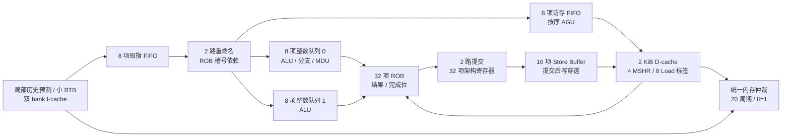

# Area-v2：以 40,000 面积为约束重新设计

2026-09-21。新路线是 **两路分派/提交、两个专用整数端口加一个访存端口、32 项 ROB 的小窗口乱序 CPU**。
旧四路通用乱序设计停止作为面积达标路线；旧说明归档在
[fourwide-v1.md](docs/archive/fourwide-v1.md)，现有 `rtl/` 保留为正确性基线。

**完整 v2 CPU 已实现**，入口为 [cpu_top.sv](designs/area_v2/rtl/cpu_top.sv)，
构建与验证见 [designs/area_v2](designs/area_v2/README.md)，最终实测见 [实现报告](reports/area_v2.md)。
下文的面积预算和轨迹模型保留为选型依据，不替代实现报告中的完整 RTL 测量。
**六项分别 IPC ≥1.014 的要求已全部通过；最低 IPC 为 1.038772。**
本轮通过 64 B D-cache 行和单比特局部历史预测消除剩余瓶颈，
同源码对照见 [IPC 修复报告](reports/area_v2_ipc.md)。总 IPC 仅作统计。

## 1. 更换架构的依据

两个已完成映射的旧版本分别为 213,372.88、197,299.37；后一版本仅触发器面积就有
36,856.42。这些数字属于有哈希的冻结版本，不能冒充当前工作树面积。
即使以较小者为起点，也要削减约 79.7% 才能达到 40,000。
证据见 [旧综合报告](reports/synthesis.md)、[后一次完整映射](reports/data/full_mapping_parallel_events.json)。

旧核心直接改成两路发射，六项实测总 IPC 从 1.092137 降至 0.987759；仅把 D-cache
缩成 2 KiB 则为 0.984031；PLRU 加 16 MSHR 的 2 KiB 实验也只有 0.996049。
因此必须改变数据存放、端口、恢复和缓存事务结构，不能只缩小旧实现。

保持原验收契约：RV32IM、统一 32 位内存接口、读写延迟 20 周期、每周期最多一笔请求、
最多 64 笔在途、冷缓存、包含退出排空。目标为 **面积 ≤40,000、每个 benchmark 的 IPC ≥1.0140、频率 ≥300 MHz**，
三项必须由同一配置的完整 RTL 证明。外存不计面积，全部片上存储计入标准单元面积。

## 2. 选定配置

| 项目 | Area-v2 | 结构约束 |
| --- | ---: | --- |
| 取指 / 分派 / 提交 | 2 / 2 / 2 | 每拍每个队列最多分派一条；最多提交一条 Store |
| 执行端口 | 2 整数 + 1 访存 | 端口 0 承担分支、MDU；端口 1 为整数 ALU；访存独立 |
| ROB | 32 项 | 结果保存在 ROB 槽位；槽号就是在途生产者标签 |
| 架构寄存器 | 32×32 位 | 4 读、2 写；提交更新 |
| ROB 结果存储 | 32×32 位 | 4 个分派读端口 + 2 个提交读端口；3 个结果写源 |
| 操作数队列 | 8 + 8 + 8 项 | 两个整数队列各选一条；访存队列严格 FIFO |
| 分支检查点 | 4 个 | 只保存 RAT 有效位/槽号和必要队列边界 |
| Load 事务槽 | 8 项 | 取消后仍保留事务标签，直至迟到响应排空 |
| Store Buffer | 16 项 | 容纳已执行未提交和已提交未响应的 Store |
| I-cache | 1 KiB，直接映射 | 32 B 行；奇偶字分两个 32 位 bank；1 个填充事务 |
| D-cache | 2 KiB，2 路 | 64 B 行；4 个行 MSHR；每字有效；写穿透、写不分配 |
| 分支预测 | 64 项单比特局部历史 + 256 项两比特计数器 + 32 项 BTB | 2 查询、1 训练端口；保存取指时的预测历史 |
| 数据缓存端口 | 1 读 + 1 写 | fill 与 Store 在进入阵列前仲裁 |
| Load 命中目标 | 发射到结果 1 周期 | 须验证完整调度/AGU/cache/写回路径 |

最多发射 3 条，但分派和提交均为 2，不把它称为三路通用超标量。ROB 容量、各队列容量、
整数端口数、提交宽度、缓存容量与 MSHR 是后续参数化轴。这里没有独立 PRF：有效物理结果
容量为 `32 + ROB_ENTRIES`，物理寄存器敏感度通过 ROB 结果容量解释，不能继续声称两者独立。

## 3. 重命名与执行

RAT 每个架构寄存器只保存 `{pending, ROB_slot}`。无在途写者时读架构寄存器；
在途结果完成时读 ROB 结果表；尚未完成则把槽号放入操作数队列，等待结果总线。
两路分派顺序折叠 RAT，第二条可以依赖第一条。写 x0 不分配映射。

源数值存入 24 项操作数队列；三个固定结果源广播槽号和值，只有等待该槽号的源更新。
每个整数队列只做一次 8 选 1 的年龄选择；访存只查看 FIFO 头。
取消全局多次 oldest selection、PRF free list、old_pdst 回收和四路通用写回仲裁。

MDU 输出与端口 0 普通结果共用一个结果通道，以小缓冲及发射背压保留结果。
端口 1 和 Load 各有固定结果通道。操作数更新后下一拍才执行消费者，不能把两个相关 ALU
串在同一组合周期里虚增 IPC。新分派指令也不能同拍执行。

ROB 保留精确完成、异常和按序退休状态，架构寄存器只在提交更新。
issue metadata 每项预留 80 位，覆盖立即数、PC、预测目标、操作码、槽号及访存控制，
避免只算标签而遗漏实际负载。未连接的退休调试记录可以裁剪，真实执行与恢复状态不能裁剪。

## 4. 恢复与槽位重用

五周期恢复的轨迹模型不足 1.014，因此选定四个分支检查点。
RAT 加四个快照已经实现为 [v2_rename.sv](designs/area_v2/rtl/v2_rename.sv)，面积 1,211.92。
快照保存分支自身目的映射更新之后的状态，排除同拍更年轻指令；检查点不足则停止新分支分派。
恢复目标为两个前端损失周期，恢复 RAT、ROB tail 和 PC，并取消年轻队列项和结果。
实际损失必须由完整 RTL 计数器测量。

**不靠短 epoch 处理重用。** 生产者提交时，按 `{rd,slot}` 同时清除 RAT 和所有检查点
中的相应 pending 位；否则恢复会把已提交的旧槽号误认成新写者。
规定提交槽位下一周期才能再次分配。定向测试覆盖“保存→旧写者提交→槽号重用→恢复”，
另有 5,000 周期随机映射测试。

内存使用独立的 8 项事务标签。取消 Load 后保留 canceled 记录，响应到来只释放事务槽，
不能写 ROB；ROB 槽可以先重用。MDU 和短流水结果同样按恢复边界清除有效位。
分支检查点不承担外部事务的生命周期管理。

## 5. LSU：按序发出，取消重放网络

Load/Store 在 8 项访存 FIFO 中按序发出。头部源操作数就绪后才推进，年轻 Load
不能越过尚未解析的 Store，因此不需要内存违例检查矩阵、逐字节 owner、Load 重放检查点
和全 ROB Store 地址扫描。

Store 地址/数据生成后进入 16 项缓冲，并在 ROB 标记完成；提交后才能修改缓存或外存。
后续 Load 只在该缓冲查找最近的重叠 Store。最近一条完整覆盖 Load 时前递；部分覆盖时
初版等待相关老 Store 排空，再读缓存，不实现多条 Store 的逐字节拼接。
这会影响窄访存密集程序性能，但避免重新引入旧 LSU 的大规模合并网络。

Load 缺失释放 AGU，用独立事务槽等待；后续内存操作仍可发出，最多 8 项。
返回数据受一个 Load 结果通道背压。同一行可以共享填充，但不再给缓存设置
32 项通用结果 waiter 队列；等待者身份由已有事务槽保存。

## 6. 固定端口的专用缓存

D-cache 写穿透、写不分配：Store miss 只入外存写队列，hit 更新已有有效字。
移除 dirty 字节、victim 写回、WB MSHR、逐字节填充合并和退出清脏控制。
代价是 Store 外存流量增加；模型为每条提交 Store 计入真实 20 周期写响应，没有省略。

Load miss 默认按 64 B 行填充，关键字先发先返回，其余 15 字继续通过统一 32 位总线发送。
行长由 `DCACHE_LINE_BYTES` 参数控制；MSHR 计数、字索引、有效位和错误位均按行长生成。
逐字按需填充的模型表现很差，初版不采用。MSHR 锁定 victim way 至填充结束；冲突替换
和同一行 Store 等待填充完成，防止迟到读覆盖已提交写。读错误保留相应字无效并通知
相关等待者，错误路径等待者仍须排空。

阵列只有 1R1W。Load 可读，fill 与 Store 先仲裁成一个写事件。
标签/word-valid 更新也须在写口预算内仲裁，不能整合时又恢复多端口动态下一状态数组。
写口、标签端口冲突及结果争用必须计入完整 RTL 周期。

I-cache 独立实现：奇偶 32 位 bank 支持从行内任意字开始取两条，只在行边界截断，
不在每个 8 B 边界截断。用一个填充事务和 8 项取指 FIFO，没有 RAS 和多标签请求池。
直接 JAL 预译码；条件分支用局部历史选择两比特计数器；间接转移用小 BTB。
默认每个历史槽保存最近一次已解析条件分支的方向，64 个槽用 PC 索引；PC 与历史拼接索引
256 项计数器。取指包和执行队列携带查询时的历史，分支解析时训练原计数器；历史允许
错误路径污染，不参与架构状态恢复。`LOCAL_HISTORY_BITS=0` 恢复原 bimodal，供参数对照。

退出只识别 ROB 头的合法 `SW 0x80000000`。停止新工作后排空已提交 Store、取消 Load、
I/D 填充和统一外存响应，然后发唯一退出写，退出退休与外存接受同沿。
写穿透取消清脏扫描，**没有取消排空或缩短写入延迟**。

## 7. 面积账本和硬预算

18 类结构已做 ASAP7 映射。复合 Load 路径与缓存数组重叠，份数为零，不重复相加。
全部存储映射成标准单元，没有 RAM 宏/黑盒。以下是原型账本，**不是整核面积，也不是整核面积的严格上下界**。
端口数、输入/工具哈希和原始结果见 [area_v2_feasibility.json](reports/data/area_v2_feasibility.json)。

| 已映射结构 | 面积 |
| --- | ---: |
| D-cache 数据 + 两路标签/有效字预留 | 11,824.58 |
| I-cache 双 bank 数据 + 标签预留 | 5,713.73 |
| 架构寄存器 + ROB 结果 + ROB metadata | 4,449.32 |
| 队列 metadata + 操作数 + 两个选择器 | 4,352.01 |
| RAT + 4 个分支检查点 | 1,211.92 |
| Store / miss / fill 缓冲 + 取指 FIFO | 1,501.33 |
| BHT + BTB | 1,189.44 |
| **合计** | **30,242.33** |

未完成部分不能算作零，其分配预算为：

| 尚需整合/实现的部分 | 分配上限 |
| --- | ---: |
| MDU 及结果缓冲 | 1,800 |
| ALU、AGU、分支比较、译码 | 600 |
| Store 匹配、前递、Load 生命周期控制 | 600 |
| I/D-cache 控制、替换、请求/响应仲裁 | 1,700 |
| ROB 完成位、分配、提交、取消控制 | 1,000 |
| 前端、预测器有效位和控制 | 600 |
| 外存控制、退出与错误处理 | 400 |
| **合计** | **6,700** |

内部整核目标约 **36,942**，距 40,000 留约 3,058 给整合和时序修正。
6,700 是尚需实现并遵守的预算，不是实测值。组件超支就重新审查架构，不能持续扩容再寄望综合器收拾。
同口径 4 KiB D-cache 数据阵列已经需要 21,777.97，比 2 KiB 多约 10,882，
会直接突破余额；本路线不能把 D-cache 加回 4 KiB 来挽救 IPC。

## 8. 性能筛选与主要风险

以下保留早期按总 IPC 筛选的历史记录。这个口径不能证明逐项达标，相关“门槛余量”和选型通过判断不再作为验收依据。

模型先用独立解释器执行六个真实镜像，核对退出值、精确指令数及完整 256 KiB RAM，再以
真实依赖和地址调度轨迹。ROB/队列/MSHR/事务槽/Store 缓冲均有限；统一 RAM II=1、延迟 20、
信用 64；冷启动、Store 响应和退出排空计入周期。

**模型不是 RTL 仿真。** 没有错误路径队列占用和缓存污染，没有完整前端流水，也未覆盖全部
前递/Load 返回争用和标签端口冲突；恢复损失是输入参数。这些数字不能用于课程 IPC 验收。

| 新设计内部方案 | 六项模型总 IPC | 决策 |
| --- | ---: | --- |
| 按序执行、2 周期 Load、2 周期恢复 | 0.932704 | 排除 |
| 小窗口乱序、2 周期 Load、5 周期恢复 | 0.978126 | 排除 |
| 小窗口乱序、2 周期 Load、4 检查点/2 周期恢复 | 1.061327 | 余量偏小 |
| **小窗口乱序、1 周期 Load、4 检查点/2 周期恢复** | **1.137281** | **选定候选** |
| 检查点方案、逐字按需填充、2 周期 Load | 0.675712 | 排除 |

选定项 374,104 条指令、328,946 个模型周期。相对 1.014 门槛只有约 12.16% 的额外周期余量，
不是保证。错误路径/前端整合成本超过它时，候选仍会失败。算术平均不能替代总退休数/总周期。

单周期 Load 是设计条件。已把 32 位地址加法、范围/对齐检查、两路标签、数据选择、窄 Load 扩展
及结果寄存器合成 [v2_load_hit.sv](designs/area_v2/rtl/v2_load_hit.sv)。该局部路径无寄生、
理想时钟的 OpenSTA setup 临界周期为 932.16 ps；RAT/检查点为 562.81 ps。
它们支持继续尝试 3,333.333 ps 的目标，但没有包含整核发射选择、广播扇出及真实布线。
两者理想 I/O 约束下最差 hold slack 约 -3.52/-3.40 ps，仍需修正和完整验证，不能称作时序全通过。

## 9. 已实现的集成与验收入口

`cpu_top.sv` 已实现 ROB、三组操作数队列、固定结果通道、RAT/分支恢复、按序访存、
Store Buffer、独立 Load 标签及精确退出；`v2_frontend.sv` 和 `v2_dcache.sv` 是完整专用缓存/前端。
复用原项目的译码、整数运算、分支、乘除法及统一外存控制模块，使用原退休差分与 RAM 模型。
根目录默认 `make` 现在构建 Area-v2；旧 `rtl/` 和旧测试入口保留作历史基线。

实现中修复了 Store hit 和同拍新 Load 替换其 way 的冲突：新行分配时阻止该 Store 更新被重用的物理行，
避免新 tag 的有效字误指向旧 Store 数据。新回归在原实现第 28 条退休的 Load 上复现错误，
修复后经过逐条差分与冲突事件计数验证。

年龄选择采用平衡树，并用单独的节点信号兼容随附 Verilator 5.020。
对原数组树和新节点树进行了全部输入的 SAT 等价证明，没有屏蔽组合环路告警。
缓存有效位每行只做一次完整字节更新，保持周期行为，同时减少仿真调度开销。

整核综合从冻结构建源码导出 Verilog-2005，全部片上存储映射为标准单元。
ABC 组合分区重接后，对共享高扇出网插入真实 ASAP7 缓冲树；时钟不改动、I/O 时序约束不放宽。
脚本收缩新增缓冲后逐一核对所有原单元引脚连接，所有缓冲面积计入最终统计，再进行完整 STA。

最终报告包含 3/20 周期全程序差分、系统背压/故障测试、带 RAT 不变量检查的机制回归、
Verilog 导出一致性、参数敏感度和独立运行时间测量。模型预测与早期原型面积继续作为历史资料；
最终是否达标以 [实现报告](reports/area_v2.md) 对同一完整配置的测量为准。
