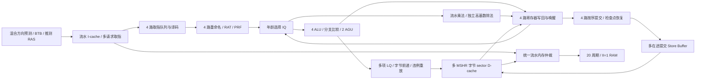

# CPU 2026：面向性能的 RV32IM 乱序架构

版本 v1.0，2026-09-21。本稿替代早期的保守实现方案。用户已明确允许流水内存，并要求在 20 周期内存延迟下达到 1.0140 IPC；串行正确性版本只保存在 Git 标签 `baseline-correct-serial`，不作为新实现的兼容模式。

课程输入仅为现有三个子模块，CPU、内存仿真、验证和综合入口由本项目提供。上游 README 中关于另一个 Framework 的说法不适用。

## 1. 目标与验收

- 实现题目指定 RV32IM 子集，额外支持 LB/LBU/LH/LHU。
- 所有 25 个现有程序检查退出值、精确退休条数、完整 256 KiB 最终 RAM，并逐条退休差分。
- 性能测量使用冷缓存、固定 20 周期读写延迟，包含启动、重定向、Store 排空、清脏和退出退休。
- 目标 IPC 不低于 1.0140；汇总口径未另指定时，同时公布总退休数/总周期及六项 IPC 算术平均。
- 题目面积上限与至少 300 MHz 需同一配置的综合、时序证据；IPC 通过不能代替面积和频率验收。
- 所有可测结果绑定 RTL 版本、参数、工具和内存契约；没有完成的物理指标不填估计值。

首轮四路性能实现已完成两种延迟下全部程序差分。其 20 周期六项总 IPC 为 1.395353，算术平均为 1.492278。逐程序结果、后续优化和最终选定参数以 `reports/` 的实测报告为准，不能把该首轮数值套用到其他参数配置。

## 2. 内存契约

本实现选择一个统一的 32 位、小端 RAM 接口，容量 256 KiB，地址范围 0–0x3FFFF。请求可以每周期接受一笔，默认允许 64 笔在途，响应严格按请求顺序返回。32 位总线宽度与 64 信用是本实现的选择，不是额外的课程规定。固定模型中，一笔在周期 C 接受的请求在 C+20 提供响应；正确性模式可用 C+3。读写均遵守延迟，写入在完成响应时对外部 RAM 生效，读观察所有更老已完成写入。

请求和响应均使用 valid/ready；背压期间保持 valid 与内容。请求与响应可以同周期发生，包括在途队列满时的出队/入队交接。随机增加等待和请求背压只用于压力验证，不能缩短规定延迟。

外存数据宽度仍为 32 位；缓存行逐字发送，并使用流水能力重叠这些字的等待。没有将整条行伪装成一次 20 周期的字访问，也没有预热或预装缓存。

这套契约依据用户明确授权，不沿用旧版“32 位、单在途”的自定假设。历史串行数据在 `reports/serial-baseline.json`。

## 3. 流水与默认配置

| 参数 | 性能中心配置 | 约束与用途 |
| --- | ---: | --- |
| FETCH/RENAME/ISSUE/WB/COMMIT_WIDTH | 各 4 | 独立支持 1、2、4 |
| PHYS_REGS | 128 | 至少 32+重命名宽度；不要求二次幂 |
| ROB_ENTRIES | 64 | 环形年龄；上限 128，配合内部标签 |
| IQ_ENTRIES | 32 | 非二次幂容量可用 |
| LQ/SQ/CSB_ENTRIES | 各 32 | LQ/CSB 标签各最多 128 项 |
| FETCH_QUEUE_ENTRIES | 32 | 取指解耦队列 |
| FETCH_REQUESTS | 16 | 独立取消、独立保留返回状态 |
| ICACHE_BYTES / WAYS / MSHRS | 4096 / 2 / 4 | 每拍至多返回四个连续字 |
| DCACHE_BYTES / WAYS / MSHRS | 16384 / 4 / 8 | 一个 CPU 阵列请求/拍，多请求在途 |
| LINE_BYTES | 32 | 支持 16/32/64 B |
| cache WAITERS | I=FETCH_REQUESTS，D=32 | 容量覆盖前端在途请求；同一行可合并多个等待者 |
| MAX_MEM_OUTSTANDING | 64 | 统一外存信用数 |
| BHT_ENTRIES / BTB_ENTRIES | 2048 / 256 | 二次幂表容量 |
| HISTORY_BITS / PREDICTOR_MODE | 8 / tournament | bimodal、gshare、tournament 可实测比较 |
| RAS_DEPTH | 16 | 支持 0–16；推测更新与快照恢复 |

中心配置用于性能探索，不能据此推定符合 40,000 面积上限。较小缓存、窗口和队列配置也必须真实测量，选型以 IPC、面积、时序三者共同结果为准。

## 4. 前端与预测

I-cache 每个 CPU 请求携带起始字地址、1–4 字数量和标签。取指只在缓存行边界或第一个预测跳转处截断，不因 8 B 对齐块的后半部分而降低成单取指。

前端有独立请求标签池与当前路径顺序 FIFO。多个请求可同时在途，缓存乱序返回按原顺序送入取指队列；冷缺失可以与后续请求重叠。被重定向的标签保留取消状态，直到已呈现的请求握手及响应排空；新路径使用其他空闲标签，不等待所有旧读完成。标签不能因 ROB 或 epoch 回绕而误匹配。

BTB 记录完整 PC 标签、目标和控制指令提示。方向预测支持 bimodal、gshare 及两者的 tournament；chooser 使用取指时保存的两个分量结果训练，避免用提交时已改变的计数器重构旧预测。最多四条控制转移在一周期按退休年龄训练，碰到同一个表项时折叠更新，不丢训练事件。

RAS 在取指时推测更新，按 x1/x5 的调用、返回及协程提示处理。每条记录携带其之前的历史/RAS 快照。重定向恢复快照并应用实际控制转移，Load 重放仅恢复快照。首次遇到未命中 BTB 的直接 JAL 可在返回预译码时修正前端并取消其后记录。

取指请求前检查完整 PC 的对齐与范围，非法地址不进入外存。缓存返回四位逐字错误掩码：成功前缀正常入队，首个失败字产生带原始 PC、inst_valid=0 的 fault；前面的跳转仍可取消该年轻 fault。包内某一字失败不将整包错误归属到第一条指令。

## 5. 重命名、执行与提交

复位 x0–x31 映射 p0–p31，初始值为零；p32 以上为空闲。x0 不分配目的寄存器，但写 x0 不取消 Load、跳转等行为。

四路重命名按程序顺序折叠 RAT，后一路源和 old_pdst 观察前一路的新映射。ROB、IQ、目的物理寄存器和所需 LSQ 容量按连续前缀原子分配。同周期提交回收、写回置就绪与分配更新由统一下一状态逻辑管理。

IQ 按相对 ROB head 的年龄选择。四个整数端口均支持 ALU/分支操作；每周期最多两个 AGU 操作和一条 MDU 请求。选择/读数之后有执行寄存器，执行结果经接受后直接旁路到下一轮选择与操作数读取，使相关 ALU 链每周期可推进一条。不会在一个组合周期串行执行两条相关 ALU。

物理寄存器最多四路写回，按年龄仲裁；未获接受的执行结果或 Load/MDU 结果保留。无 GPR 写入的 Store/分支完成状态通过元数据通路更新 ROB，不占用不需要的 PRF 写端口。

ROB 按序退休最多四条，不越过未完成或 fault 的队首，也不越过退出 Store。RRAT 和回收旧物理寄存器按同周期年龄顺序更新。同周期多条 Store 可以进入 CSB；同周期多条分支可以训练预测器。

## 6. 一周期检查点恢复

恢复 RAT 由 RRAT 和仍存活的 ROB 写者组合重建：按环形年龄顺序选每个架构寄存器最年轻的存活写者。分支保留自身目的映射，Load 重放排除自身及年轻映射。该计算在一个时钟沿生效，不增加扫描停顿；物理实现不保存每条 ROB 的完整 RAT 副本。仿真中保留独立的分配时检查点作为逐次恢复断言的参考。预测历史和 RAS 仍携带快照，ROB/结果带槽位与代际号。

控制转移实际 next-PC 不等于预测时，在该周期选择最老恢复边界，屏蔽年轻写回、分派、发射与退休。一个时钟沿恢复 RAT、回收年轻目的、重设 ROB tail/count，并清除相应 IQ 与执行状态。分支自身保留，Load 重放则清除该 Load 自身及所有年轻记录。

多个分支同周期完成或更老分支在年轻重定向之后完成时，始终选择最老边界。没有逐项扫描 ROB 的恢复停顿，也没有通过保存会回绕的小 epoch 代替真正取消。

不能撤销的缓存读只保留取消后的等待者。其 LQ 标签直到响应排空才能重用，物理寄存器和 ROB 则可按检查点正常回收；迟到结果没有架构写回资格。MDU 按 ROB 标签选择性取消全部对应流水级和输出缓冲，较老操作继续执行。

## 7. 推测 LSU 与提交 Store

每条 Load 有独立的 LQ 项、缓存标签、地址、请求状态、结果缓冲和前递快照。多个 Load 可同时执行、缺失和完成；没有“只准一个活动 Load”的限制。

Store 地址可以先于数据生成。Load 可越过地址尚未知的老 Store；老 Store 首次解析地址时检查已经执行的年轻 Load，发现真实字节冲突则从最老违规 Load 的前检查点重放。字节已从该 Store 之后的更年轻 Store 前递时，不把被覆盖的写当成违例。

对已知地址冲突，按 CSB 再 SQ 的年龄顺序逐字节选择最近写入。被更新的字节可以分别来自不同 Store；较年轻且数据已就绪的 Store 覆盖更老未就绪写后，不再等待被覆盖的数据。需要的最近写入数据未就绪时，Load 记录具体等待 Store 并释放 AGU，数据就绪后再发射；无关 Load 继续前进。

部分前递的字节、mask 和必要来源身份在发请求前锁存。CSB 排空或 Store 退休不会使返回合并依赖已释放的记录。SQ 到 CSB 的同周期迁移没有前递空隙。

CSB 支持多项已接受但尚未响应的缓存请求，按程序序列发出，同地址由缓存等待者 FIFO 保序，响应可以有不同延迟。记录完成后按 CSB 头的连续前缀回收。只有已退休 Store 能修改 D-cache。

## 8. 缓存、仲裁与退出

I-cache 数据采用整行存储字与两个读端口，D-cache 采用 32 位存储字与三个读端口。CPU 侧 I-cache 可返回四字，D-cache 仅需一字，其等待者结果缓冲也只存一字。缓存位图按窄行、窄字选取，避免多维 packed 动态切片展开为整片位图移位器。缓存每个字节有 valid/dirty 位。完整字 Store 分配时直接写入并置有效，不为纯写数据读取旧 RAM；窄 Store 也只修改对应字节。Load 缺少的字节由填充补齐，已知或脏字节不会被晚返回数据覆盖。

不同 MSHR 锁定不同 way，多等待者按同一行的请求 FIFO 处理。命中在其他缺失期间继续前进。关键请求字准备好即返回，剩余行填充继续；未被请求的预取字出错只保留该字无效，不倒追已经成功返回的其他字。

victim 写回和退出清脏只发送实际脏字节对应的字事务，并流水化发出。MSHR 用独立发出/完成记录跟踪每个字，统一控制器用响应归属 FIFO 路由 I/D 结果。写回响应失败保留脏数据并触发全局调试错误。

退出仅识别到达 ROB 头的 SW 0x80000000。先停止新架构工作、取消年轻等待者，继续排空 CSB、填充与写回；所有遗留事务完成后才独占清脏。清脏写全部成功完成、缓存及控制器确认空闲后，才发唯一退出写。退出退休和 halted 与外部接受事件同一沿发生，DONE 状态不再请求或退休。

## 9. ISA 与乘除法

译码检查 opcode/funct3/funct7；支持指定 RV32IM 及窄 Load。JAL/JALR 链接值为 PC+4，JALR 只清 bit0。实际 taken 目标非四字节对齐在控制转移自身报错；未 taken 分支不因候选目标非对齐报错。完整地址用于越界检查，不能截断后映射到 RAM。

乘法器接受请求后一个周期给出结果，可每周期接收一条乘法，输出与三个弹性结果槽保留背压能力。独立除法器默认每周期处理四个恢复位，按有效被除数位数跳过前导零组，最多八次迭代。除零、溢出、单位除数和小被除数有精确快捷路径；同操作数及符号模式的连续 DIV/REM 可复用已完成的商余数。乘除结果带独立标签，可乱序完成，输出仲裁和缓冲保证背压不丢结果。

MULHSU 正确处理混合符号高半部；有符号除法向零截断，余数与被除数同号。除零及最小负数/-1 按 ISA 返回规定值，不产生异常。

不支持 CSR、特权态、中断、ECALL/EBREAK、FENCE/FENCE.I、压缩、浮点、原子操作或自修改代码。非法指令及访存 fault 只有到 ROB 头才停止；错误路径 fault 可取消。

## 10. 验证与复现

根目录 `make build/test/test-system/test-isa/test-cache` 为主要入口；前端、核心检查点和 LSU 另有独立监测回归。所有新增机制都要求既检查架构结果，也证明关键事件实际发生：四路取指/退休、多个在途请求、检查点恢复、Store 地址未知时 Load 越过、重放、接受前取消、迟到错误及 ROB/物理寄存器重用。

仿真默认关闭波形和周期日志，保留按程序汇总计数：退休 0–4 条周期分布、分支恢复、Load 重放、缓存缺失、外存请求/写、在途周期/峰值、运行时间和 RSS。事件存在重叠，不伪造互斥停顿分解。

SystemVerilog 经固定版本 sv2v 导出 Verilog，并在 Yosys 中检查和综合。导出文件必须可用同一仿真器验证；调试端口在综合包装层不连接，允许优化掉专供验证的数据与计数器。Cache/PRF/队列的真实片上实现计入面积，不用黑盒隐去。
