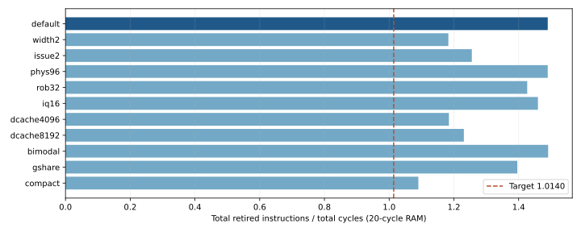
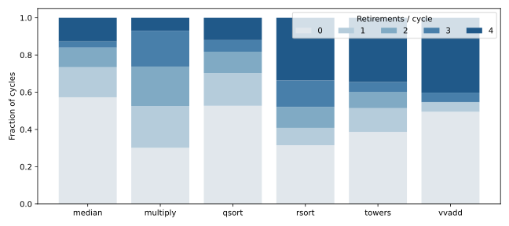

# 参数敏感度报告（历史性能探索批次）

以下为 `4235e29` 时期的冻结测量，源码哈希保存在数据文件中，不代表当前综合修复后的物理结果。该批次中心配置在 20 周期内存延迟下，总 IPC **1.489920**，六项 IPC 算术平均 **1.550394**。目标为 1.0140；两种汇总方式分别为目标的 1.469 和 1.529 倍。

数据来自实际 Verilator RTL 仿真。外存统一为 32 位、II=1、64 在途、有序响应；每笔读写等待 20 周期，冷复位，包含启动、恢复、Store 排空和清脏。原始版本/源码哈希、参数和逐程序数据保存在 [data/measurements.json](data/measurements.json)，表格数据见 [data/performance.csv](data/performance.csv)。

每个扫描点都检查六项程序的退出值、精确退休数、完整最终 RAM。中心配置另完成所有 25 个程序在 3/20 周期下的逐指令差分。未写出的参数沿用该批次源码的 cpu_top 默认值，不能拿其他版本默认值解释历史数据。

| 配置 | 参数变化 | 总 IPC | 算术平均 | 相对中心总 IPC |
| --- | --- | ---: | ---: | ---: |
| default | 默认中心配置 | 1.489920 | 1.550394 | +0.00% |
| width2 | FETCH_WIDTH=2, RENAME_WIDTH=2, ISSUE_WIDTH=2, WB_WIDTH=2, COMMIT_WIDTH=2 | 1.182911 | 1.201867 | -20.61% |
| issue2 | ISSUE_WIDTH=2 | 1.255433 | 1.304909 | -15.74% |
| phys96 | PHYS_REGS=96 | 1.489920 | 1.550394 | +0.00% |
| rob32 | ROB_ENTRIES=32 | 1.426511 | 1.405392 | -4.26% |
| iq16 | IQ_ENTRIES=16 | 1.459616 | 1.507047 | -2.03% |
| dcache4096 | DCACHE_BYTES=4096 | 1.184601 | 1.409150 | -20.49% |
| dcache8192 | DCACHE_BYTES=8192 | 1.230800 | 1.425614 | -17.39% |
| bimodal | PREDICTOR_MODE=0 | 1.491191 | 1.492115 | +0.09% |
| gshare | PREDICTOR_MODE=1 | 1.395926 | 1.504317 | -6.31% |
| compact | PHYS_REGS=80, ROB_ENTRIES=32, IQ_ENTRIES=24, LQ_ENTRIES=16, SQ_ENTRIES=16, CSB_ENTRIES=16, FETCH_QUEUE_ENTRIES=16, ICACHE_BYTES=1024, DCACHE_BYTES=4096, RAS_DEPTH=8 | 1.090174 | 1.228394 | -26.83% |

## 逐程序结果

| 程序 | 退休数 | 周期 | IPC | 分支恢复 | D-cache 缺失分配 | 峰值在途 |
| --- | ---: | ---: | ---: | ---: | ---: | ---: |
| perf_median | 6961 | 7110 | 0.979044 | 295 | 152 | 20 |
| perf_multiply | 21722 | 14431 | 1.505232 | 663 | 53 | 20 |
| perf_qsort | 139900 | 130605 | 1.071169 | 10539 | 516 | 20 |
| perf_rsort | 195719 | 93584 | 2.091372 | 53 | 1408 | 20 |
| perf_towers | 5278 | 2866 | 1.841591 | 76 | 12 | 20 |
| perf_vvadd | 4524 | 2494 | 1.813953 | 13 | 151 | 20 |

逐程序 IPC 与汇总 IPC 是不同要求。本报告的达标结论针对上面明确列出的两种汇总公式，不声称每一个程序都分别超过 1.0140。缓存缺失计数包含 sector 补齐所分配的 MSHR，不能直接当成不同缓存行数。

## 指标解释

`width2` 同时改变全链路宽度，`issue2` 只改变执行发射宽度；二者区分执行资源与前后端带宽。`phys96`、`rob32` 和 `iq16` 各自只改变一类容量。缓存点保持 core 参数不变；`compact` 是明确列出参数的联合面积探索点，不能称为单因素结果。

bimodal/gshare/tournament 使用相同缓存、流水和内存。chooser 只根据实际取指时保存的两个分量预测训练；不会使用基准程序名称、已知答案或离线轨迹作为硬件预测输入。

面积/频率须按同一配置独立测量，当前 IPC 达标不等于完整评分达标。综合的实际阶段、工具版本和限制见 [synthesis.md](synthesis.md)。不把未知面积填成 0，也不绘制虚构的 IPC–面积 Pareto 图。

