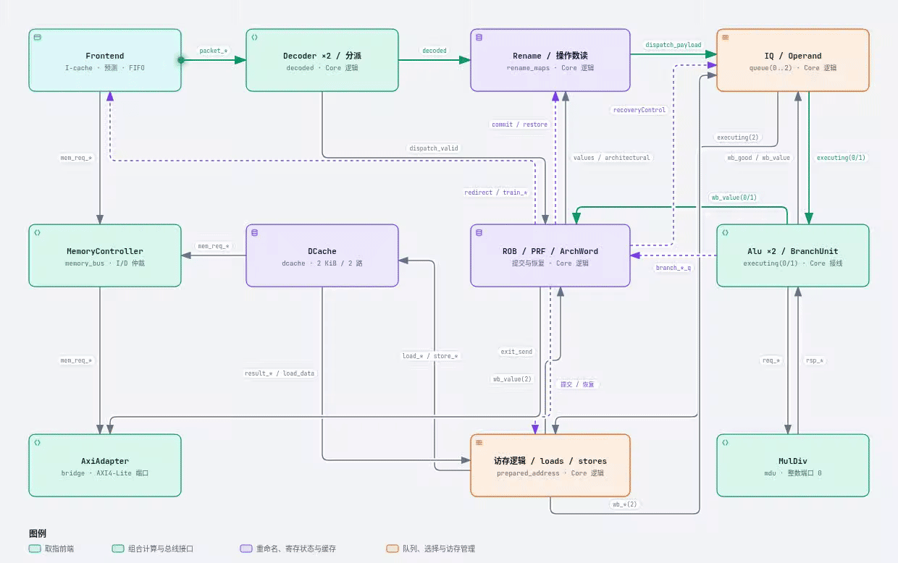
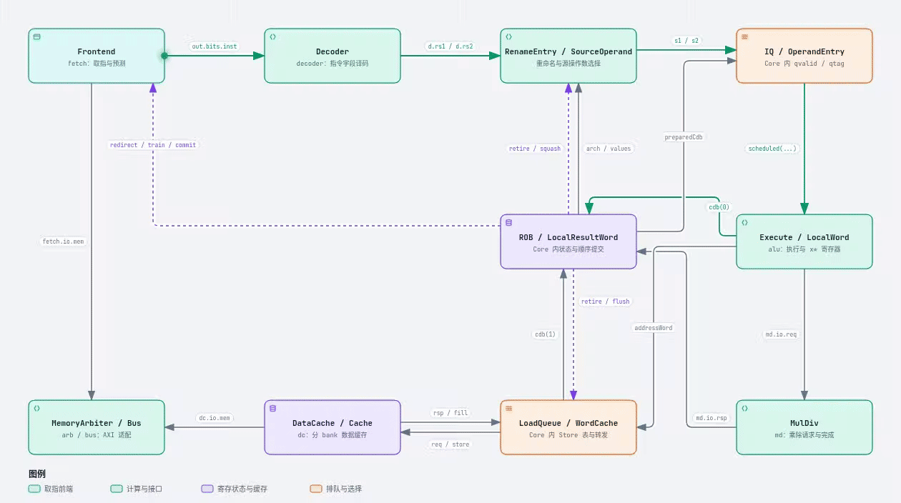

# ParaRisc

## 项目简介

项目展示首页：[本地静态展示](docs/site/index.html)；GitHub Pages 发布后使用项目站点 `/CPU/` 路径访问。首页只携带架构图和入口，不上传完整实验归档。

RV32IM CPU 工程，包含可参数化多发射乱序 Chisel CPU、独立单发射 Chisel CPU，以及双发射 Verilog 参考实现。**根目录默认构建双发射 Chisel 的已生成 RTL**：[verilog/filelist.f](verilog/filelist.f) 指向 [dual-issue-chisel/rtl/student_top.sv](dual-issue-chisel/rtl/student_top.sv)。`make` / `make code`、`make build/test/perf/synth` 均沿用这一默认入口；`make` 还会将编译出的模拟器复制为课程提交文件 `./code`。

## 实现对照表

| 实现 | 定位 | 可编辑源码 | 课程输入 filelist |
| --- | --- | --- | --- |
| **双发射 Chisel（默认）** | 主线参数化 CPU；双分派、双提交、两个整数端口及独立 LSU | [tier3 Scala](dual-issue-chisel/src/main/scala/tier3/)，顶层 [Top.scala](dual-issue-chisel/src/main/scala/tier3/Top.scala) | 根 [verilog/filelist.f](verilog/filelist.f)，或直接使用 [dual-issue-chisel/rtl/filelist.f](dual-issue-chisel/rtl/filelist.f) |
| 单发射 Chisel | 独立单发射/单提交 CPU，用于单发射设计、参数及面积/时序实验 | [tier2 Scala](single-issue-chisel/src/main/scala/tier2/)，顶层及生成器在 [Core.scala](single-issue-chisel/src/main/scala/tier2/Core.scala) | [single-issue-chisel/rtl/filelist.f](single-issue-chisel/rtl/filelist.f) |
| 双发射 Verilog 参考 | 保留的参考电路，用于独立构建、迁移对照和等价检查 | [模块源码](verilog/area_v2/)、[顶层](verilog/student_top.sv)、[AXI 适配器](verilog/pararisc_axi_adapter.sv) | 显式指定 [verilog/reference_filelist.f](verilog/reference_filelist.f) |

三套交付顶层均名为 `student_top`，分别构建，不把它们的 filelist 合并使用。filelist 中的 RTL 路径相对于该 filelist 所在目录解析。

- **双发射生成**：`make -C dual-issue-chisel generate` 经 sbt 调用 [tier3.Generate](dual-issue-chisel/src/main/scala/tier3/Generate.scala)，从可编辑源码生成 `rtl/student_top.sv` 和 `rtl/elaboration.json`。
- **单发射生成**：`make -C single-issue-chisel generate` 调用 [generate_baseline.py](single-issue-chisel/scripts/generate_baseline.py)，依据 [baseline.json](single-issue-chisel/baseline.json) 从选定报告的冻结 Chisel 源码重建并核对电路，再发布字节一致的已测 RTL。直接从可编辑 `src/` 生成实验版本使用该目录的 `tier2.Generate` / sbt 入口，见[单发射说明](single-issue-chisel/README.md)；默认交付不会自动采用 `src/` 中的实验修改。
- **Verilog 导出**：`make export-verilog` 调用 [export_plain.py](scripts/area_v2/export_plain.py)，将 `verilog/area_v2/*.sv` 导出为 [area_v2_core.v](verilog/area_v2_core.v) 及哈希清单。参考 filelist 另包含上述顶层和适配器；导出不会切换根目录默认实现。

两套 Chisel 工程均使用各自的 `build.sbt`，版本为 Chisel 6.5.0、Scala 2.13.12、sbt 1.10.2、firtool 1.62.0。旧 Mill 原型和初始计划在 [archive/](archive/README.md)。

## 默认实现架构入口

默认 [dual-issue-chisel](dual-issue-chisel/README.md) 的总体图包含 11 个核心组件，标明独立模块和 `Core` 内部逻辑分组，并提供职责、主要 I/O、源码位置及 ADD 主路径。默认 `issueWidth=3` 统计两个整数端口加一个 LSU 的新发射总上限；目录名“双发射”描述双分派和两个整数端口。



[交互图 HTML](docs/architecture/dual-issue-overview.html) · [可编辑图源](docs/architecture/dual-issue-overview.json) · [源码盘点](docs/architecture/dual-issue-overview.md) · [文字架构说明](docs/architecture.md)

强调实线展示 ADD 数据路径，普通实线表示其他数据和请求，虚线表示提交、恢复与预测训练控制。GIF 展示连接方向，不代表逐周期时序。GitHub 首页播放 GIF；下载 HTML 后用浏览器打开，可选择节点、切换导览、缩放和播放动效。[使用与验证说明](docs/architecture/README.md)。

## 快速运行

以下命令均在仓库根目录执行。先按 [config.mk](config.mk) 和[课程工具说明](README-ZH.md) 配置 AppImage 或原生 Verilator / Yosys / OpenSTA / ASAP7。使用已提交的 RTL 构建模拟器不需要 sbt；只有重新生成 Chisel RTL 才需要 Chisel 工具链。示例启用 `APPIMAGE_EXTRACT_AND_RUN=1`，适用于无法使用 FUSE 的环境。

### 默认双发射 Chisel

```sh
git submodule update --init --recursive
APPIMAGE_EXTRACT_AND_RUN=1 make build BUILD=build/default JOBS=8
make test SIM=build/default/sim LATENCY=10 MAX_CYCLES=20000000
make perf SIM=build/default/sim LATENCY=10 MAX_CYCLES=20000000
```

额外延迟检查、综合及历史证据审计：

```sh
make test SIM=build/default/sim LATENCY=20 MAX_CYCLES=20000000
make perf SIM=build/default/sim LATENCY=20 MAX_CYCLES=20000000
APPIMAGE_EXTRACT_AND_RUN=1 make synth SYNTH_OUT=build/default-synth
python3 dual-issue-chisel/scripts/audit_requirements.py
```

最后一条只核对当前输入和归档的哈希、日志与汇总，不重新执行仿真或 STA。原生 Chisel 单元检查、参数矩阵和逐拍对照的命令见[双发射工程说明](dual-issue-chisel/README.md)及[验证报告](dual-issue-chisel/reports/requirements-2026-10-16/report.md)。

### 独立单发射 Chisel

```sh
APPIMAGE_EXTRACT_AND_RUN=1 make -C single-issue-chisel build
make -C single-issue-chisel test LATENCY=20
make -C single-issue-chisel perf LATENCY=20
```

该 Makefile 使用自己的 `FILELIST`，默认模拟器为 `single-issue-chisel/build/default/sim/sim`，测试上限为 30,000,000 周期。可用 `LATENCY=10` 重跑另一组延迟。综合入口为 `make -C single-issue-chisel synth`；复现已归档 v110 测量优先使用[报告中的 reproduce.sh](single-issue-chisel/reports/area-recovery-2026-10-21/reproduce.sh)，它使用英文临时路径规避已记录的工具路径编码问题，并保留新日志。

### Verilog 参考实现

```sh
APPIMAGE_EXTRACT_AND_RUN=1 make build \
  FILELIST=verilog/reference_filelist.f BUILD=build/reference JOBS=8
make test SIM=build/reference/sim LATENCY=20 MAX_CYCLES=20000000
make perf SIM=build/reference/sim LATENCY=10 MAX_CYCLES=20000000
make perf SIM=build/reference/sim LATENCY=20 MAX_CYCLES=20000000
make verify-rtl
APPIMAGE_EXTRACT_AND_RUN=1 make synth \
  FILELIST=verilog/reference_filelist.f SYNTH_OUT=build/reference-synth
```

`make verify-rtl` 检查的是 Verilog 参考模块。`SIM=...` 会使用指定的已构建模拟器并跳过 RTL 编译；切换实现时同时使用对应的构建目录和 `SIM` 路径，避免测到另一套 CPU。

## 当前结果与测量条件

三套实现的统一基准表见[统一实验索引](reports/experiments/README.md)，机器可读版本为 [index.csv](reports/experiments/index.csv) 和 [index.json](reports/experiments/index.json)。首页下表只引用其中三条当前基准；它们是历史归档数值，本次整理没有重新测量。

下表是**已归档测量**，本次文档整理没有重新运行 CPU 仿真、综合或 STA。结论只适用于对应报告记录的源码、RTL、参数、工具和约束，不代表任意参数组合或官方最终评分。

| 实现 / 归档日期 | Fmax MHz | 总面积 μm² | 全部六项性能 IPC 几何平均，延迟 10 / 20 | 正确性记录 | 证据 |
| --- | ---: | ---: | --- | --- | --- |
| 默认双发射 Chisel，2026-10-16 | 502.70 | 35,930.97 | 1.222171 / 1.113846 | 延迟 10 / 20 各 19/19 | [完整要求与输入证据](dual-issue-chisel/reports/requirements-2026-10-16/report.md) |
| 单发射 Chisel v110，2026-10-21 | 422.44 | 17,933.13 | 0.87846442 / 0.84602401 | 延迟 10 / 20 各 19/19 | [v110 报告](single-issue-chisel/reports/area-recovery-2026-10-21/report.md)、[机器可读记录](single-issue-chisel/latest-measurement.json) |
| 双发射 Verilog 参考，2026-10-16 | 503.69 | 35,900.33 | 1.222171 / 1.113846 | 延迟 20 为 19/19 | [阶段 10 报告](reports/dual-issue/frequency-stage10.md)、[原始归档](reports/data/2026-10-16/timing-stage10/clean-default/) |

这些归档使用课程 ASAP7 RVT TT 综合/STA 流程：2.0 ns 目标、`INVx1_ASAP7_75t_R` 驱动、5 fF ABC 负载、0.2 ns 输入/输出延迟及 0.05 ns 时钟不确定度。Fmax 来自最小可行周期估计，是理想时钟、无布线寄生的结果；设置 `CLOCK_PERIOD_NS=2.0` 本身不证明达到 500 MHz。单发射 v110 的最小周期为 2.3671875 ns，在 2.0 ns 下仍为负 slack，未达到 500 MHz。

面积包含实际使用的 FakeRAM：双发射两套归档的 SRAM 项为 0，缓存触发器面积计入逻辑；单发射 v110 的 SRAM 面积为 2,910.44 μm²，已计入总面积。阶段和工具流程变化会改变面积及频率，不能混用不同报告的结果。逐拍 AXI 对照与组件形式证明的范围见 [v13 历史验收](dual-issue-chisel/reports/final/report.md)，参数实验见 [14 组参数敏感度](dual-issue-chisel/reports/requirements-2026-10-16/parameter-sensitivity.md)。

多发射主线的 104 分档目标仍是全部必需正确性、总面积 ≤36,000 μm²、全部官方 `perf_*` 的 IPC 几何平均 ≥1.0985、实测 Fmax ≥500 MHz 同时满足；上表为具体配置的本地历史证据。

## 深入阅读入口

| 入口 | 内容 |
| --- | --- |
| [项目文档索引](docs/README.md) | 架构、参数、AXI、SRAM 和两套架构图 |
| [测量与验证报告索引](reports/README.md) | 按实现区分的验收、阶段历史、输入身份和原始日志 |
| [双发射 Chisel 工程](dual-issue-chisel/README.md) | 默认源码生成、原生单元、参数矩阵、形式证明及逐拍对照 |
| [单发射 Chisel 工程](single-issue-chisel/README.md) | 冻结基准生成、实验参数、v110 与历史阶段 |
| [Agent 工程指令](AGENTS.md) | 实现入口、协作约束和验证规则 |
| [GitHub Actions 验证](docs/ci.md) | PR 中的 Chisel 生成一致性与快速检查，手动完整回归/性能/综合 |
| [产物与实验归档规则](docs/artifacts.md) | 大型产物审计、可验证打包、清单和 Release 附件迁移 |
| [课程中文说明](README-ZH.md) / [English](README-EN.md) | 评测接口、工具链与要求 |
| [历史原型与计划](archive/README.md) | 停用的 RTL、Mill 原型和初始计划 |

### 保留的单发射 Chisel 架构图

下图对应 **`single-issue-chisel/` 的独立单发射实现**。默认双发射实现使用上方的另一张图；两套图源、HTML 和验证证据分别保留。



[单发射交互图 HTML](docs/architecture/single-issue-overview.html) · [单发射可编辑图源](docs/architecture/single-issue-overview.json) · [图表索引与源码快照说明](docs/architecture/README.md)。动画表示连接方向，不是 CPU 周期仿真。
